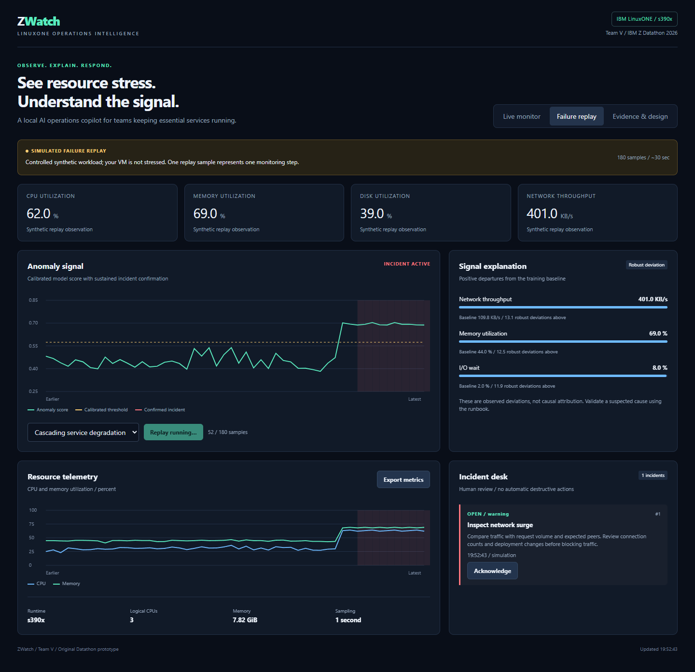

# ZWatch - Team V

**Local anomaly intelligence for LinuxONE operations.** Built for IBM Z Datathon 2026 under Real-Time AI for Critical Decisions / System Anomaly Detection.

ZWatch collects real Linux system metrics, scores unusual resource behavior locally with Isolation Forest, confirms sustained signals, and turns them into explainable incidents with human review runbooks. A separate replay model demonstrates five failure patterns and a healthy control without stressing the actual VM.



**Submission materials:** [pitch deck](docs/Team-V-ZWatch-Pitch.pdf), [architecture](docs/architecture.svg), [evaluation JSON](evidence/evaluation.json), [submission draft](docs/submission-answers.md).

## What works

- Live CPU, memory, root filesystem, network rate, load per CPU, and I/O wait collection using psutil.
- Separate live and synthetic models. Live training uses 80 real observations and a separate 40-observation calibration set after a 120-sample warmup.
- Isolation Forest with 128 trees, a calibration threshold at the 99.5th percentile, positive robust baseline deviations, and explicit critical resource guardrails.
- Three consecutive abnormal observations open an incident. Three clean observations resolve it. This is incident hysteresis, not predictive forecasting.
- Incident acknowledgment, SQLite WAL storage, audit records, CSV export, evaluation JSON export, input validation, token authentication, and same-origin mutation protection.
- Responsive dashboard with no external front-end/CDN dependency.
- Six repeatable held-out synthetic scenarios; dataset seeds and runtime are included in the evidence export.

## Honest scope

This is a production-oriented single-VM prototype, not a production-certified monitoring platform. Synthetic replay accuracy does not establish real-world accuracy. The live baseline is intentionally short for a demo and must be replaced with a longer, vetted representative baseline for operations. Explanations report baseline deviations, not proven root causes. No automated remediation is executed.

The deployment runs Python AI inference on IBM LinuxONE / s390x CPU. It does not use or claim Telum acceleration, protected execution, high availability, or confidential computing. VM system counters are read from inside a container; the root filesystem metric refers to its root filesystem, not every host volume.

## Run locally

Requires Python 3.12+ on Linux for the live collector.

```bash
python -m venv .venv
. .venv/bin/activate
pip install -r requirements.txt
python -m uvicorn app:app --host 127.0.0.1 --port 38900 --workers 1
```

The first start creates `.access-token` (owner-only permissions on Linux). Read it locally and enter it in the dashboard at `http://127.0.0.1:38900`. Never commit this file. For an existing secret, set `ZWATCH_KEY_FILE` to its path. Set `ZWATCH_DATA_DIR` to a writable persistent data directory. The API requires `Authorization: Bearer <token>`. Use exactly one worker because collection state is local to the process.

## LinuxONE deployment

The included Dockerfile pins the IBM sample environment image by digest and adds FastAPI/Uvicorn. The accompanying `requirements-lock.txt` records the exact versions used for the running demo. A locked image rebuild can replace the package ranges with those versions after review.

```bash
docker build -t zwatch:1.0 .
mkdir -p data
bash deploy.sh
# From your workstation, open an encrypted tunnel:
ssh -N -L 38900:127.0.0.1:38900 -i YOUR_PRIVATE_KEY linux1@YOUR_VM_IP
# Open http://127.0.0.1:38900 and enter the token stored on the VM in data/.access-token.
```

The deployment binds to VM loopback and uses an encrypted SSH tunnel for workstation access. `deploy.sh` preserves the data directory while replacing only the named application container. Run it as a user authorized to use Docker. For production multi-user access, terminate HTTPS with an approved reverse proxy and use organizational SSO/RBAC. All inference and telemetry storage remain on LinuxONE. No cloud AI API or paid model is required.

## Demo in under three minutes

1. Open Live monitor. Show the real s390x runtime and real CPU/memory/network counters.
2. Open Failure replay and run Cascading service degradation. The simulated label is intentionally visible.
3. Observe the score cross the calibrated threshold, three-sample confirmation, driver deviations, runbook, and recovery.
4. Acknowledge an incident and export metrics.
5. Open Evidence & design. Show held-out synthetic results, measured local inference latency, architecture, and limitations.

## Reproduce engineering checks

```bash
python -m unittest discover -s tests -v
```

Checks cover invalid telemetry rejection, spike suppression, confirmation and recovery, separate incident episodes, healthy control, and unchanged training metadata during scoring. `data/evaluation.json` is generated on service startup with independent training/calibration/evaluation seeds.

For authenticated integration checks, set `ZWATCH_TEST_URL` to the running service URL and `ZWATCH_KEY_FILE` to its secret file, then run the same command. These checks also cover authentication, foreign-origin mutation rejection, invalid scenarios and exports, and source separation. CSV exports contain the most recent 240 observations for the selected source; SQLite retains the most recent 20,000 observations.

## Resources and data provenance

- Isolation Forest / scikit-learn: https://scikit-learn.org/stable/modules/generated/sklearn.ensemble.IsolationForest.html
- NumPy: https://numpy.org/
- psutil: https://github.com/giampaolo/psutil
- FastAPI: https://github.com/fastapi/fastapi
- Uvicorn: https://github.com/encode/uvicorn
- Python / SQLite standard library: https://www.python.org/ and https://www.sqlite.org/
- IBM LinuxONE sample environment: https://github.com/linuxone-community-cloud/jupyter-lab-ml

Replay data is generated by this project's `normal_workload` and `replay` functions. No external real customer or patient dataset is used. Raw live metrics and access tokens are excluded from the public repository. AI assisted implementation and documentation. Team V is responsible for reviewing the solution and disclosing assistance as required by the organizers.
